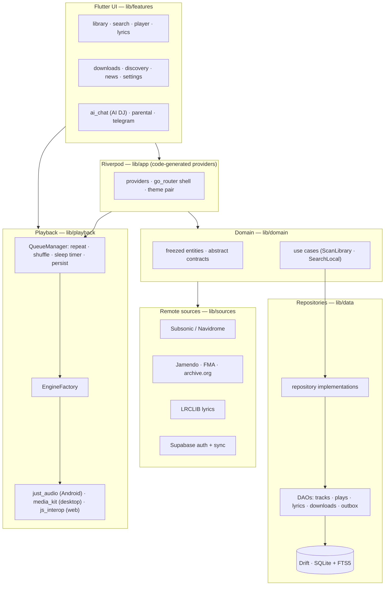

<div align="center">

# 🎵 Wavely

**Your music, your way. Cross-platform, offline-first, and AI-powered.**

A free, open-source, glassmorphic music player for **legal sources only** —
your local files, your own Subsonic/Navidrome server, and free catalogs
(Jamendo, Free Music Archive, archive.org). No ads, no paywall, no PII
tracking.

[](https://github.com/Dani-Devlop/Music_Wavely/actions/workflows/verify.yml)
[](https://github.com/Dani-Devlop/Music_Wavely/actions/workflows/verify.yml)
[](#getting-started)
[](LICENSE)
[](https://github.com/Dani-Devlop/Music_Wavely/releases)
[](docs/CONTRIBUTING.md)

</div>

---

Wavely is a **privacy-first player** that works with **zero API keys** out of
the box: scan your local library and hit play. Want more? Point it at your own
Subsonic/Navidrome server, add a free Jamendo client id, or sign in with
Telegram/Email to sync across devices via Supabase. Spotify/Deezer/Apple are
**metadata-only** through official APIs — Wavely never touches paid-catalog
audio.

## 📸 Screenshots

<!-- OWNER: Add real screenshots here.
     Drop the files into docs/assets/ with these exact names, and the
     images below will render automatically. Suggested captures:
     library home, now playing, synced lyrics, queue sheet, discovery, desktop. -->

| Home | Now Playing |
| :---: | :---: |
|  |  |
| **Synced Lyrics** | **Queue Sheet** |
|  |  |
| **Discovery** | **Desktop** |
|  |  |

## ✨ Features

### 🎧 Playback
- **Gapless** and **crossfade** transitions between tracks.
- **Background playback** on every platform.
- **Sleep timer** with fade-out.
- Three platform engines behind one contract: `just_audio` (Android),
  `media_kit` (Windows/Linux desktop), JS interop (Web).

### 📚 Library
- **FLAC / MP3 / WAV** support with metadata and embedded artwork.
- **Folder scanning** with an FTS5-backed index for instant search.
- Unified **local + online search** across all configured sources.

### 🎨 UI/UX
- **Glassmorphism** design system with 13 reusable glass components.
- **Light/Dark themes** with Material You and **Spotify Green / purple**
  accent pairs.
- Responsive shell: mini player, now-playing screen, drag-to-reorder queue.

### 🧠 Intelligence
- **AI DJ chat** — mood-based conversation that builds and reshapes the queue.
- **Synced lyrics** — embedded LRC first, then **LRCLIB** fallback.

### 🛡️ Safety
- **Parental controls** with automatic **audio beeping (censoring)** on
  flagged tracks — playback never skips, it masks.

### 🌐 Discovery
- **Legal online sources only**: your own **Subsonic / Navidrome**, **Jamendo**,
  **Free Music Archive**, **archive.org**.
- **News feeds** and artist **discovery / follow** features.
- Built-in **download manager** with folder templates, filename sanitizing,
  and per-file provenance.

### ☁️ Auth & Sync
- **Telegram / Email login** (Telegram Mini App + PWA aware).
- **Supabase sync** of plays, follows, and settings across devices.
- Crash-only reporting — paths and PII are stripped from release logs.

## 🏗️ Architecture



## 🚀 Getting Started

**Prerequisites:** [Flutter](https://docs.flutter.dev/get-started/install)
stable ≥ 3.35 (Dart ^3.9). The platform runner folders (android/, windows/,
linux/, web/) are **not committed** — they are scaffolded locally:

```bash
git clone https://github.com/Dani-Devlop/Music_Wavely.git
cd Music_Wavely

# 1. Scaffold the platform runners (safe: existing files are never touched)
flutter config --enable-windows-desktop --enable-linux-desktop
flutter create . --platforms=android,windows,linux,web --org app.wavely --project-name wavely

# 2. Enable desugaring for the Android runner (flutter_local_notifications
#    requirement — no-op if you only scaffolded desktop targets)
python3 tools/patch_android_desugaring.py

# 3. Dependencies + code generation
flutter pub get
dart run build_runner build --delete-conflicting-outputs

# 4. Configuration — optional! The local player needs NO API keys at all.
cp .env.example .env   # add JAMENDO_CLIENT_ID / Subsonic / Supabase if you want them

# 5. Run
flutter run -d linux            # or -d windows, or an Android device id
```

## ✅ Verify (what CI does on every push)

```bash
flutter analyze                                            # 0 errors required
flutter test --coverage                                    # 1173 tests passing

# Subsonic contract suite against a live Navidrome server:
docker compose -f docker-compose.navidrome.yml up -d
flutter test test/sources/subsonic/
docker compose -f docker-compose.navidrome.yml down -v
```

Every feature ships with tests; nothing is considered "done" unverified.

## 📦 Releases

Pushing a `v*.*.*` tag triggers the release workflow, which builds:

| Platform | Artifact |
| --- | --- |
| Android | `wavely-<tag>-android-arm64.apk` |
| Windows | `wavely-<tag>-windows-x64.zip` (+ unsigned MSIX) |
| Linux | `wavely-<tag>-linux-x64.tar.gz` (+ AppImage; Flatpak config in `flatpak/`) |

Artifacts are **unsigned placeholders** published with a `SHA256SUMS.txt` —
see [`docs/PACKAGING.md`](docs/PACKAGING.md) for local signing.

## 🗺️ Roadmap

Wavely is growing into a **DAP-class player** (Digital Audio Player):

- [ ] **Hi-Res audio output** (24-bit / 192 kHz paths)
- [ ] **USB bit-perfect / exclusive-mode audio** (DAP-grade output)
- [ ] **Equalizer** (per-device presets)
- [ ] **Plugin support** for third-party sources and DSP
- [ ] Signed installers (MSIX / AppImage) for the official release channel

## 🤝 Contributing

Contributions are welcome — see
[`docs/CONTRIBUTING.md`](docs/CONTRIBUTING.md). One non-negotiable ground
rule: **legal sources only**. No DRM circumvention, no unofficial paid-service
APIs, no scraping of paid-catalog audio; PRs violating this are closed
without review.

## 📚 Documentation

- [Final Verification Guide](docs/FINAL_VERIFICATION.md) — copy-paste local verify flow
- [Changelog](CHANGELOG.md) — keep-a-changelog style history
- [Privacy](docs/PRIVACY.md) · [Security Audit](docs/SECURITY_AUDIT.md) · [Packaging](docs/PACKAGING.md)
- Stage ledgers: [1.1](docs/STAGE_1_1_REPORT.md) · [1.2](docs/STAGE_1_2_REPORT.md) · [2.1](docs/STAGE_2_1_REPORT.md) · [2.2](docs/STAGE_2_2_REPORT.md) · [3](docs/STAGE_3_REPORT.md)

## 📄 License

Released under the [MIT License](LICENSE) — Copyright (c) 2026 Dani-Devlop.

<div align="center">
<sub>Built with Flutter · Drift · Riverpod · media_kit · Supabase</sub>
</div>
