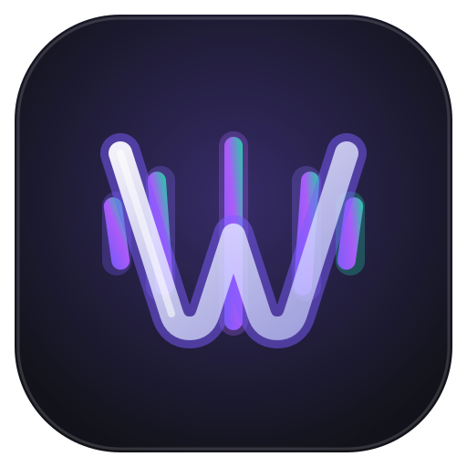
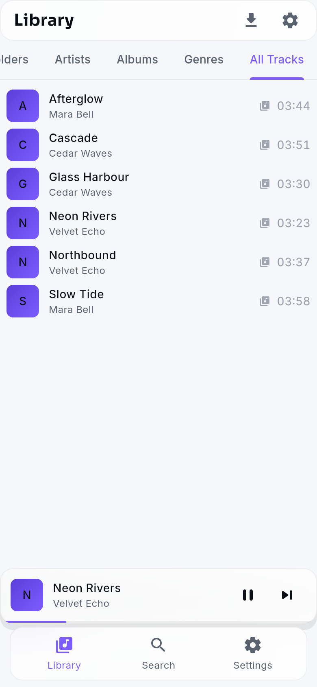
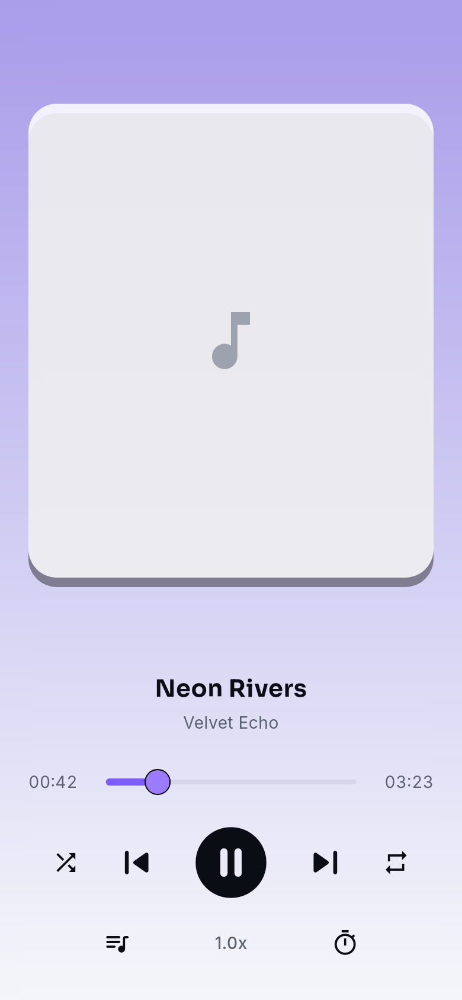
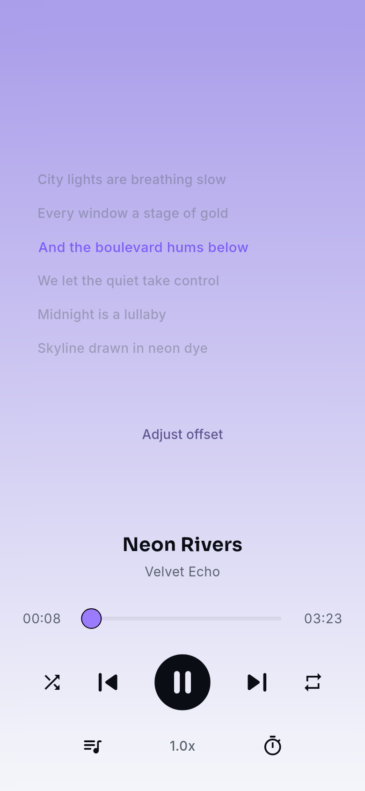
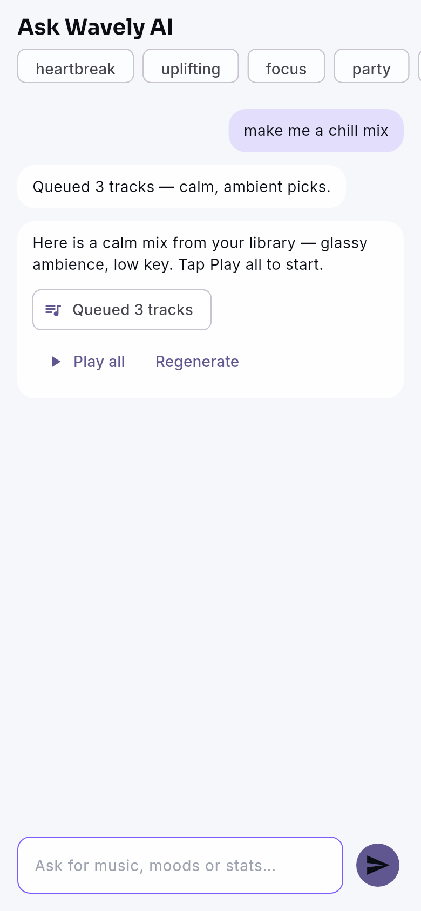
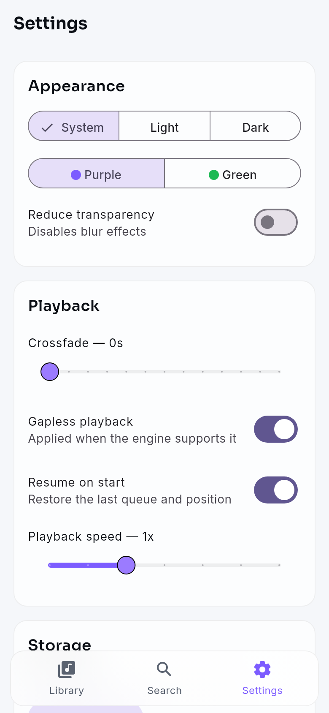
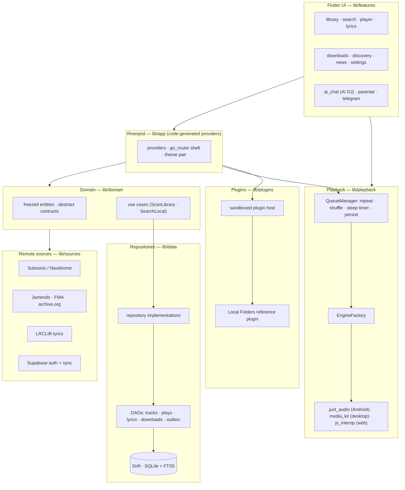

<div align="center">



# Wavely

**Your music, your way. Cross-platform, offline-first, and AI-powered.**

A free, open-source music player for **legal sources only** — your local
files, your own Subsonic/Navidrome server, and free catalogs (Jamendo, Free
Music Archive, archive.org). No ads, no paywall, no PII tracking.

[](https://github.com/Dani-Devlop/Music_Wavely/actions/workflows/verify.yml)
<br>
[](https://github.com/Dani-Devlop/Music_Wavely/releases/tag/v1.0.2)
[](#-download-v102)
[](LICENSE)

</div>

---

Wavely is a **privacy-first player** that works with **zero API keys** out of
the box: scan your local library and hit play. Want more? Point it at your
own Subsonic/Navidrome server, add a free Jamendo client id, or sign in with
Telegram/Email to sync across devices via Supabase. Spotify/Deezer/Apple are
**metadata-only** through official APIs — Wavely never touches paid-catalog
audio.

## 📥 Download v1.0.2

Grab the latest build straight from the
[v1.0.2 release page](https://github.com/Dani-Devlop/Music_Wavely/releases/tag/v1.0.2):

| Platform | Downloads |
| --- | --- |
| 🤖 **Android (Universal)** | [](https://github.com/Dani-Devlop/Music_Wavely/releases/download/v1.0.2/wavely-v1.0.2-android-universal.apk) |
| 🤖 **Android (per-ABI slim)** | [](https://github.com/Dani-Devlop/Music_Wavely/releases/download/v1.0.2/wavely-v1.0.2-android-arm64-v8a.apk) [](https://github.com/Dani-Devlop/Music_Wavely/releases/download/v1.0.2/wavely-v1.0.2-android-armeabi-v7a.apk) [](https://github.com/Dani-Devlop/Music_Wavely/releases/download/v1.0.2/wavely-v1.0.2-android-x86_64.apk) |
| 🪟 **Windows** | [](https://github.com/Dani-Devlop/Music_Wavely/releases/download/v1.0.2/wavely-v1.0.2-windows-x64.zip) [](https://github.com/Dani-Devlop/Music_Wavely/releases/download/v1.0.2/wavely.msix) |
| 🐧 **Linux** | [](https://github.com/Dani-Devlop/Music_Wavely/releases/download/v1.0.2/wavely-v1.0.2-linux-x64.AppImage) [](https://github.com/Dani-Devlop/Music_Wavely/releases/download/v1.0.2/wavely-v1.0.2-linux-x64.tar.gz) |
| 🌐 **Web / other** | Build from source — see [🚀 Getting Started](#-getting-started) |

> ℹ️ The universal APK contains every architecture — install it and Android
> picks the right one automatically. The MSIX installer ships when its
> optional packaging step succeeds; AppImage/MSIX are unsigned unless
> signing secrets are configured ([docs/PACKAGING.md](docs/PACKAGING.md)).

## 📸 Screenshots

<p align="center">
  
  
  
  
  
</p>
<p align="center">
  <sub>Library · Now Playing · Synced Lyrics (LRCLIB) · AI DJ Chat · Settings — rendered from the E2E suite on CI</sub>
</p>

## ✨ Features

### 🎧 Platform-Adaptive UI (v1.0.2)
Wavely ships **two purpose-built UIs from one codebase**, split at 800 px:

- 📱 **On Android (mobile)** — a strict **Musicolet clone**:
  - The **14-option song context menu** on long-press (Bookmarks/Notes,
    A-B repeat, Play speed & pitch, Add to a queue, Add to playlists,
    Edit tags, Move to folder, Audio cutter, Set as ringtone, Share song,
    Delete permanently, Show/hide/customize, Quick access shortcuts,
    Song info) as a dark charcoal bottom sheet.
  - **Queue manager** bottom sheet — drag handles, per-row edit/delete,
    named queue snapshots (A, B, …) and the green
    **REMOVE ALL OTHER QUEUES** button.
  - **Musicolet settings tree** with a top-right search icon, ten deep
    categories and **green section headers** (Decoder, Equalizer, Volume,
    …) in the audio sub-pages.
  - **Custom dialogs, never default AlertDialogs**: the Scan dialog with a
    big green **SCAN NOW** button and live Total / Accessible / Excluded
    stats; the Sleep-timer dialog with the exact 0:15:00 · 1:30:00 · h:mm ·
    N=5 · N=10 · "After a specific song" buttons; a dedicated **10-band
    equalizer screen** with green sliders, Custom preset label and a Save
    icon.
  - **Solid-black now playing** — massive cover art, Title / Artist /
    Album, the Heart · Info · Add-to-queue · 3-dots row and the Rewind ·
    Prev · Play · Next · FF · EQ transport row. No glassmorphism.
- 🖥️ **On Windows/Linux desktop** — a premium **Spotify clone**:
  - **Three-column layout**: 250 px sidebar (logo, Home, Search, Library,
    Playlists on a dark gradient), the center main view (hero banner,
    "Made for you" carousels, album grid) and a 300 px right panel with
    the Now-Playing details and **Next in queue**.
  - A fixed **glassmorphic bottom playbar** — album art, transport
    controls, seekbar, volume and the device selector.
  - **Now playing on desktop**: an animated blurred album-art backdrop
    with a large cover, title and synced lyrics.

### 🎧 Playback
- **Gapless** and **crossfade** transitions between tracks.
- **Background playback** on every platform, with a live mini-player and
  drag-to-reorder queue.
- **Sleep timer** with fade-out and playback-speed control.
- Three platform engines behind one contract: `just_audio` (Android),
  `media_kit` (Windows/Linux desktop), JS interop (Web).

### 🎛️ DAP features (v0.2.0)
- **Hi-Res audio output** — 24-bit / 192 kHz paths, no forced resampling
  anywhere in the chain ([docs/HIRES_AUDIO.md](docs/HIRES_AUDIO.md)).
- **USB / exclusive-mode bit-perfect output** — mpv `audio-exclusive` on
  desktop, AAudio exclusive on Android 14+
  ([docs/HIRES_AUDIO.md](docs/HIRES_AUDIO.md)).
- **10-band equalizer** — `just_audio` `AudioPipeline` on Android, `lavfi`
  EQ on desktop, per-device presets stored in SQLite
  ([docs/DAP_FEATURES.md](docs/DAP_FEATURES.md)).
- **Plugin support** — sandboxed, compile-time plugin host with the
  "Local Folders" reference plugin
  ([docs/DAP_FEATURES.md](docs/DAP_FEATURES.md)).

### 📚 Library & Sources
- **FLAC / MP3 / WAV / M4A / OGG** support with metadata and **embedded
  album artwork** (covers are extracted during the scan and shown on every
  row, card and the full-screen player).
- **Folder scanning** with an FTS5-backed index for instant search.
- **Legal online sources only**: your own **Subsonic / Navidrome**,
  **Jamendo**, **Free Music Archive**, **archive.org**.
- Unified **local + online search** across all configured sources.
- Built-in **download manager** — folder templates, filename sanitizing,
  per-file provenance, Wi-Fi-only gate, and **true offline playback** of
  downloaded files.

### 🧠 Intelligence
- **AI DJ chat** — mood-based conversation that builds and reshapes the
  queue ("make me a chill mix" → a validated queue you can play or
  regenerate).
- **Synced lyrics** — embedded LRC first, then **LRCLIB** fallback, with
  auto-scroll, active-line highlighting, tap-to-seek and manual offset.

### 🛡️ Parental Controls
- **PIN-gated** management screen with an audit trail.
- **Blocked words** drive automatic **audio beeping (censoring)** through
  the offline ffmpeg pipeline — the original file is never modified.
- Artist / album / genre blocklists and a no-lyrics fail-safe policy
  (block · mute · allow).

### 🎨 Design System
- **Album art everywhere** — embedded covers on tiles, mini-player, home
  cards, the queue manager and the full-screen player; a premium
  hash-gradient + white-note fallback for tracks without artwork (never a
  letter box).
- **Glassmorphism** component set with dark-gradient desktop panels.
- **Light / Dark / AMOLED** themes with purple/green accent pairs,
  adaptive accent from album art, blur-strength and corner-radius controls,
  plus full **Persian / RTL** localization.
- Typography: **Sora** (headings) + **Inter** (body), bundled under the
  SIL Open Font License.

### ☁️ Auth & Sync
- **Telegram / Email login** (Telegram Mini App + PWA aware).
- **Supabase sync** of plays, follows, and settings across devices —
  offline-first with an outbox queue.
- Crash-only reporting — paths and PII are stripped from release logs.

## 🏗️ Architecture



## 🚀 Getting Started

**Prerequisites:** [Flutter](https://docs.flutter.dev/get-started/install)
stable ≥ 3.35 (Dart ^3.9). The platform runner folders (android/, windows/,
linux/, web/) are **not committed** — they are scaffolded locally:

```bash
git clone https://github.com/Dani-Devlop/Music_Wavely.git
cd Music_Wavely

# 1. Scaffold the platform runners (safe: existing files are never touched)
flutter config --enable-windows-desktop --enable-linux-desktop
flutter create . --platforms=android,windows,linux,web --org app.wavely --project-name wavely

# 2. Patch the Android runner for Wavely's plugin set (desugaring +
#    minSdk 26; no-op if you only scaffolded desktop targets)
python3 tools/patch_android_desugaring.py

# 3. Dependencies + code generation
flutter pub get
# 3b. home_widget ships jvmTarget 1.8 Kotlin that the compiler's inliner
#     rejects — raise it in the pub cache (run AFTER pub get)
python3 tools/patch_android_jvm_target.py
dart run build_runner build --delete-conflicting-outputs

# 4. Configuration — optional! The local player needs NO API keys at all.
cp .env.example .env   # add JAMENDO_CLIENT_ID / Subsonic / Supabase if you want them

# 5. Run
flutter run -d linux            # or -d windows, or an Android device id
```

| Platform | Build |
| --- | --- |
| **Android** | `flutter build apk --release` (or `--split-per-abi`) |
| **Windows** | `flutter build windows --release` |
| **Linux** | `flutter build linux --release` |
| **Web** | `flutter build web` |

## ✅ Verify (what CI does on every push)

```bash
flutter analyze                                            # 0 errors required
flutter test --coverage                                    # full suite green

# E2E scenarios + real-UI screenshots (the ARTEMIS-mirror suite):
flutter test test/e2e test/goldens

# Subsonic contract suite against a live Navidrome server:
docker compose -f docker-compose.navidrome.yml up -d
flutter test test/sources/subsonic/
docker compose -f docker-compose.navidrome.yml down -v
```

Every feature ships with tests; nothing is considered "done" unverified.
The [`e2e.yml`](.github/workflows/e2e.yml) workflow additionally builds a
debug APK in the cloud on every push.

## 📦 Releases

Pushing a `v*.*.*` tag triggers the release workflow, which builds:

| Platform | Artifacts |
| --- | --- |
| Android | `wavely-<tag>-android-universal.apk` + `armeabi-v7a` / `arm64-v8a` / `x86_64` ABI splits |
| Windows | `wavely-<tag>-windows-x64.zip` (+ MSIX when its optional packaging step succeeds) |
| Linux | `wavely-<tag>-linux-x64.tar.gz` + AppImage (+ Flatpak when configured) |

AppImage/MSIX are unsigned unless signing secrets are configured — see
[`docs/PACKAGING.md`](docs/PACKAGING.md) for local signing.

## 🗺️ Roadmap

- [x] **v0.1.0** — core player: library, playback engines, synced lyrics,
      online sources, downloads, auth & sync
- [x] **v0.2.0** — DAP stage: Hi-Res output, equalizer, plugin host,
      multi-arch release pipeline; Stage 5 cross-feature regression suite
- [x] **v1.0.0** — **stable**: instrumented E2E verification of the four
      critical user flows, real-UI screenshot capture on CI, bundled
      Sora/Inter typography, cloud debug-APK pipeline
- [x] **v1.0.1-beta / beta3** — **Musicolet parity**: 20 multi-queue
      system, 9-tab library, tag editor, audio cutter, 5-band EQ +
      ReplayGain, lock-screen queue & lyrics, home widgets, Persian/RTL;
      then the UI overhaul (real embedded album art everywhere, four bottom
      tabs, deep settings tree, Spotify-style home)
- [x] **v1.0.2** — **Responsive UI rebuild**: Musicolet Android clone
      (14-option context sheet, queue manager, scan/sleep dialogs, 10-band
      EQ screen, solid-black player) + Spotify desktop clone (3-column
      glassmorphism, bottom playbar, blurred-art now playing) from one
      codebase
- [ ] Plugin UI surface (management screen + declarative REST plugins)
- [ ] DSP extension surface (crossfeed, loudness normalization)

## 🤝 Contributing

Contributions are welcome — see
[`docs/CONTRIBUTING.md`](docs/CONTRIBUTING.md). One non-negotiable ground
rule: **legal sources only**. No DRM circumvention, no unofficial
paid-service APIs, no scraping of paid-catalog audio; PRs violating this are
closed without review.

## 📚 Documentation

- [Final Verification Guide](docs/FINAL_VERIFICATION.md) — copy-paste local verify flow
- [Changelog](CHANGELOG.md) — keep-a-changelog style history
- [Privacy](docs/PRIVACY.md) · [Security Audit](docs/SECURITY_AUDIT.md) · [Packaging](docs/PACKAGING.md)
- [DAP Features](docs/DAP_FEATURES.md) · [Hi-Res Audio](docs/HIRES_AUDIO.md)
- Stage ledgers: [1.1](docs/STAGE_1_1_REPORT.md) · [1.2](docs/STAGE_1_2_REPORT.md) · [2.1](docs/STAGE_2_1_REPORT.md) · [2.2](docs/STAGE_2_2_REPORT.md) · [3](docs/STAGE_3_REPORT.md)

## 📄 License

Released under the [MIT License](LICENSE) — Copyright (c) 2026 Dani-Devlop.
The bundled **Sora** and **Inter** typefaces are distributed under the
[SIL Open Font License 1.1](https://openfontlicense.org/).

<div align="center">
<sub>Built with Flutter · Riverpod · Drift · media_kit · Supabase</sub>
</div>
