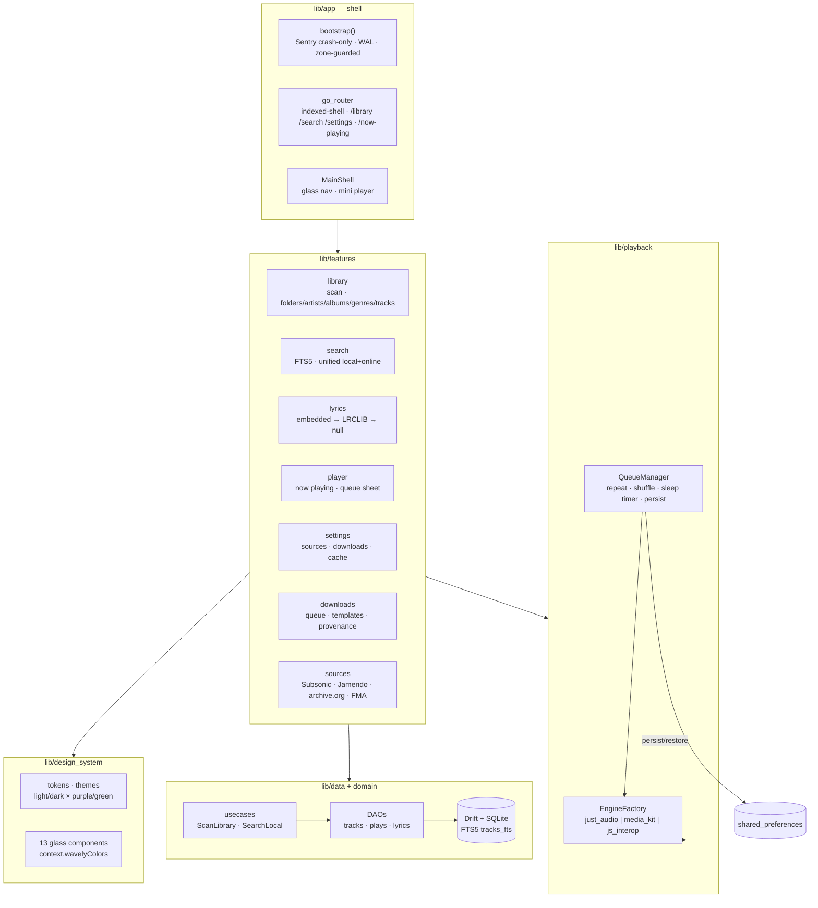

# Wavely

A glassy, privacy-first music player for **legal sources only** — your local
files, your own Subsonic/Navidrome, and free catalogs (Jamendo, Free Music
Archive, archive.org). Metadata-only support for Spotify/Deezer/Apple. No ads,
no paywall, no PII tracking (crash-only reporting, optional).

> **Status — Stages 1.1 / 1.2 / 2.1 / 2.2 authored; verification pending
> local run.** All merged work was authored in an environment without a
> Flutter/Dart SDK, so nothing has been compiled or executed yet. Stage 2.2
> (News, Telegram Mini App, PWA, desktop packaging) is authored on the
> `feat/stage-2.2` branch (see
> [`docs/STAGE_2_2_REPORT.md`](docs/STAGE_2_2_REPORT.md)), PR open, not yet
> merged.
>
> 👉 **Start here:** [`docs/FINAL_VERIFICATION.md`](docs/FINAL_VERIFICATION.md)
> — consolidated copy-paste verification flow, known risks, expected
> first-run behavior, and hygiene steps.
>
> Per-stage ledgers: [`docs/STAGE_1_1_REPORT.md`](docs/STAGE_1_1_REPORT.md),
> [`docs/STAGE_1_2_REPORT.md`](docs/STAGE_1_2_REPORT.md),
> [`docs/STAGE_2_1_REPORT.md`](docs/STAGE_2_1_REPORT.md),
> [`docs/STAGE_2_2_REPORT.md`](docs/STAGE_2_2_REPORT.md).

## Quick start

```bash
flutter create wavely --org app.wavely --platforms android,windows,linux,web
# overlay this tree over the generated project, then:
flutter pub get
dart run build_runner build --delete-conflicting-outputs
flutter analyze
flutter test --coverage
flutter run -d linux                          # or -d <android-device>
```

Copy `.env.example` to `.env` locally (never committed). The local player
needs **no API keys at all**; online sources need only `JAMENDO_CLIENT_ID`
plus your own Subsonic/Navidrome credentials — see
[`docs/FINAL_VERIFICATION.md`](docs/FINAL_VERIFICATION.md) §5d.

## Architecture



## Folder structure

```
lib/
  app/            bootstrap, router, theme pair, main shell
  core/           errors (Result/Failure), constants, extensions, utils
  data/
    local/db/     Drift tables, DAOs, FTS5, migrations
    repositories/ Drift-backed port implementations
  domain/         entities (freezed), abstract contracts, usecases
  features/
    library/      scanner + 5-tab library UI
    search/       local FTS + unified online search
    lyrics/       LRC parser, providers, synced view
    player/       now playing, queue, mini player
    settings/     AppSettings, sources + downloads sections
    downloads/    download manager, folder templates, sanitizer
  sources/        Subsonic/Navidrome · Jamendo · archive.org · FMA
  playback/       engine abstraction + 3 platform engines, queue, shuffle
  design_system/  tokens, themes, 13 components
test/             unit · widget · contract · integration-style (1028 tests)
```

## Non-negotiables

- **Legal sources only.** No DRM circumvention, no stream ripping, no paid-
  catalog downloads. Spotify/Deezer/Apple are metadata-only via official APIs.
- **Works without any API keys** in Stage 1.1 (fully local).
- **No PII**: crash-only reporting, paths stripped from release logs.
- Every feature ships with tests; nothing is "done" unverified.

## Docs

- [Final Verification Guide](docs/FINAL_VERIFICATION.md) — **start here**: copy-paste local verify flow, known risks, first-run behavior
- [Changelog](CHANGELOG.md) — stage-by-stage status incl. what is not present
- [Stage 1.1 Report](docs/STAGE_1_1_REPORT.md) — built / tests / limits / blockers
- [Stage 1.1 Audit](docs/STAGE_1_1_AUDIT.md) — file-by-file audit + fixes
- [Stage 1.2 Report](docs/STAGE_1_2_REPORT.md) — auth / sync / AI / parental / analytics
- [Stage 2.1 Report](docs/STAGE_2_1_REPORT.md) — online sources + download manager
- [Known Limitations](docs/KNOWN_LIMITATIONS_FINAL.md) — consolidated, honest
- [Metadata Sources](docs/METADATA_SOURCES.md) — live-verified API notes
- [Music_Lyrics_Embedd decision](docs/MUSIC_LYRICS_EMBEDD_REPORT.md) — 404 → own parser
