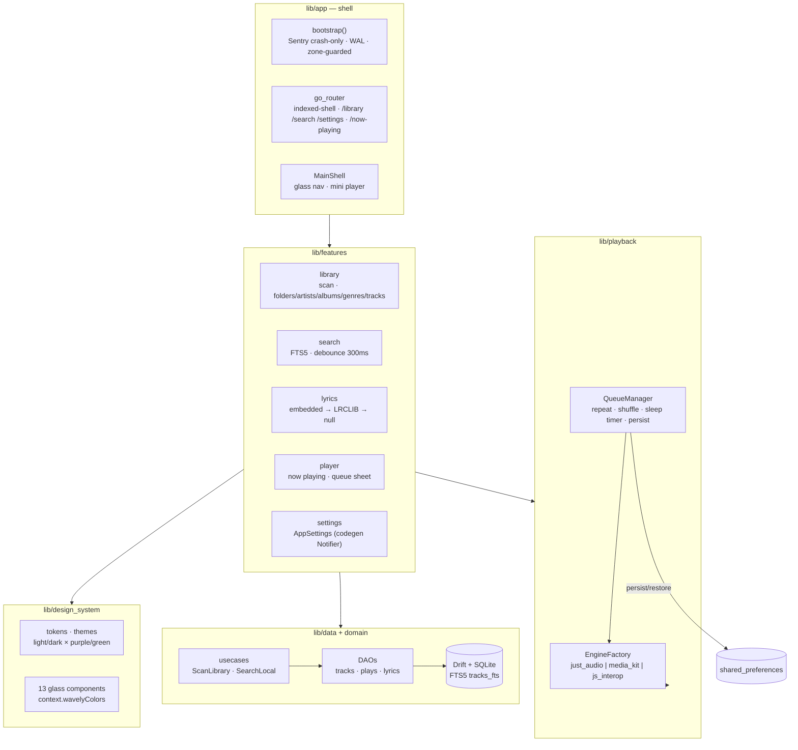

# Wavely

A glassy, privacy-first music player for **legal sources only** — your local
files, your own Subsonic/Navidrome, and free catalogs (Jamendo, Free Music
Archive, archive.org). Metadata-only support for Spotify/Deezer/Apple. No ads,
no paywall, no PII tracking (crash-only reporting, optional).

> **Status — Stage 1.1 (Local Player Core): authored complete, verification
> pending local run.** The authoring environment had no Flutter/Dart SDK, so
> nothing here has been compiled or executed yet. See
> [`docs/STAGE_1_1_REPORT.md`](docs/STAGE_1_1_REPORT.md) for the honest
> verification ledger and [`docs/STAGE_1_1_AUDIT.md`](docs/STAGE_1_1_AUDIT.md)
> for the file-by-file audit.

## Quick start

```bash
flutter create wavely --org app.wavely --platforms android,windows,linux,web
# overlay this tree over the generated project, then:
flutter pub get
dart run build_runner build --delete-conflicting-outputs
flutter analyze
flutter test --update-goldens test/goldens   # first run only (baselines)
flutter test --coverage
flutter run -d linux                          # or -d <android-device>
```

Copy `.env.example` to `.env` locally (never committed). Stage 1.1 needs **no
API keys at all** — the app is fully local.

## Architecture



## Folder structure

```
lib/
  app/            bootstrap, router, theme pair, main shell
  core/           errors (Result/Failure), constants, extensions, utils
  data/
    local/db/     Drift tables, DAOs, FTS5, migrations
    repositories/ Drift-backed port implementations
  domain/         entities (freezed), abstract contracts, usecases
  features/
    library/      scanner + 5-tab library UI
    search/       local FTS search
    lyrics/       LRC parser, providers, synced view
    player/       now playing, queue, mini player
    settings/     AppSettings + screen
  playback/       engine abstraction + 3 platform engines, queue, shuffle
  design_system/  tokens, themes, 13 components
test/             unit · widget · golden · integration-style (274 tests)
```

## Non-negotiables

- **Legal sources only.** No DRM circumvention, no stream ripping, no paid-
  catalog downloads. Spotify/Deezer/Apple are metadata-only via official APIs.
- **Works without any API keys** in Stage 1.1 (fully local).
- **No PII**: crash-only reporting, paths stripped from release logs.
- Every feature ships with tests; nothing is "done" unverified.

## Docs

- [Stage 1.1 Report](docs/STAGE_1_1_REPORT.md) — built / tests / limits / blockers
- [Stage 1.1 Audit](docs/STAGE_1_1_AUDIT.md) — file-by-file audit + fixes
- [Music_Lyrics_Embedd decision](docs/MUSIC_LYRICS_EMBEDD_REPORT.md) — 404 → own parser
