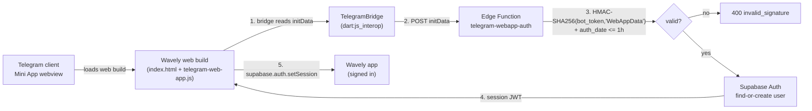

# Telegram Mini App — setup & deployment (Stage 2.2)

Wavely runs as a Telegram Mini App: the Flutter web build is served over
HTTPS and opened inside Telegram's webview, where it signs the user in via
HMAC-validated `initData`.

## 1. Architecture



Trust rules (enforced in code, test-asserted):

- The client **never** parses identity out of `initData` — the raw string
  is only relayed to the edge function.
- The edge function validates the HMAC (timing-safe), rejects data older
  than one hour and maps the Telegram id to a Supabase user.
- The bot token never leaves the server; it is never logged. `initData`
  is never logged.

## 2. BotFather setup

1. `/newbot` → create the bot (e.g. `@WavelyMusicBot`). Store the token in
   `supabase secrets set TELEGRAM_BOT_TOKEN=...` — never in the repo.
2. `/setmenubutton` → set the Mini App menu button URL to the deployed
   web build (`https://…`).
3. `/setcommands` → suggest at least:
   ```text
   start - Open Wavely
   ```
4. `/newapp` (or Bot Settings → Menu Button) → configure the Web App URL,
   short name and the 512×512 icon.

## 3. Domain verification

- The web build must be served over **HTTPS** from a domain you control.
- BotFather verifies the domain on first Mini App configuration (owner
  confirms in chat).
- Supabase Auth redirect allow-list: add the Mini App domain in
  Supabase → Auth → URL Configuration.

## 4. Deploy targets

| Target | Command sketch | Notes |
|---|---|---|
| Supabase Storage static site | `flutter build web --dart-define=TELEGRAM_MODE=true --wasm` → upload `build/web` | simplest; pair with the CDN URL |
| Vercel | `vercel deploy build/web` | add `Cache-Control` for `/assets` |
| GitHub Pages | push `build/web` to `gh-pages` | base-href must match (`--base-href=/Music_Wavely/`) |

Build flag: `--dart-define=TELEGRAM_MODE=true` switches the bootstrap into
Mini-App host mode (`ready()`/`expand()` after launch). Outside Telegram
the flag is inert.

## 5. initData validation flow

Implemented in `supabase/functions/telegram-webapp-auth/index.ts`
(deploy with `supabase functions deploy telegram-webapp-auth
--no-verify-jwt` — the function itself verifies the Telegram HMAC):

1. Parse `initData` as `URLSearchParams`; take `hash` out.
2. `data_check_string` = remaining params sorted, `k=v` joined by `\n`.
3. `secret_key = HMAC_SHA256(bot_token, "WebAppData")`.
4. `computed = HMAC_SHA256(secret_key, data_check_string)`; compare to
   `hash` **timing-safely**.
5. Reject when `auth_date` is older than **1 hour**.
6. Find-or-create the Supabase user via a deterministic email mapping
   (`<telegram-id>@telegram.wavely.app`) with a secret-derived password,
   then sign in and return the session JWT pair.
7. The client applies the session through `supabase.auth.setSession`.

Error contract (asserted in tests): `400 invalid_signature`,
`401 expired`, `401 rejected`, `500 misconfigured`, `400 rejected`
(malformed body).

## 6. Theme integration

`telegram_theme_adapter.dart` maps `themeParams`
(`bg_color`, `text_color`, `button_color`, `hint_color`) onto Wavely token
roles. A manual override switch (`telegram.themeOverride` pref) keeps the
in-app theme when the user prefers it.

## 7. Known limits

- **Background audio pauses when leaving the Mini App** — Telegram's
  webview suspends JS/audio in background; playback resumes on return.
  This is a host limitation, not a Wavely bug (see
  `docs/KNOWN_LIMITATIONS_FINAL.md` §17).
- The Mini App has no filesystem access: local-file playback and the
  download manager are unavailable in this surface by design.
- Bot-token rotation invalidates the deterministic per-user password; the
  edge function surfaces this honestly (`401 rejected` with a
  re-provision message).
